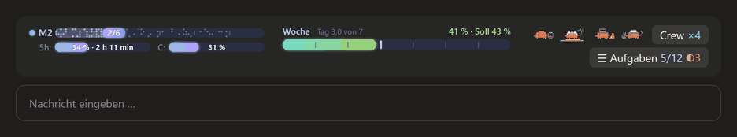
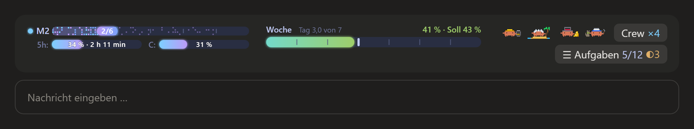
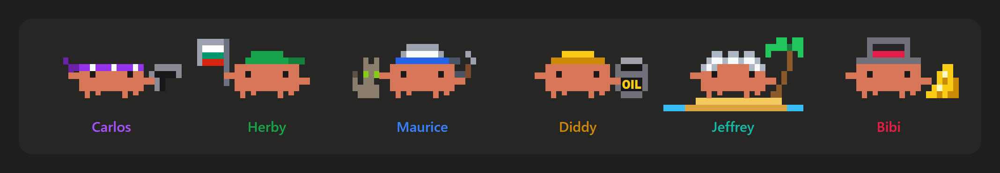
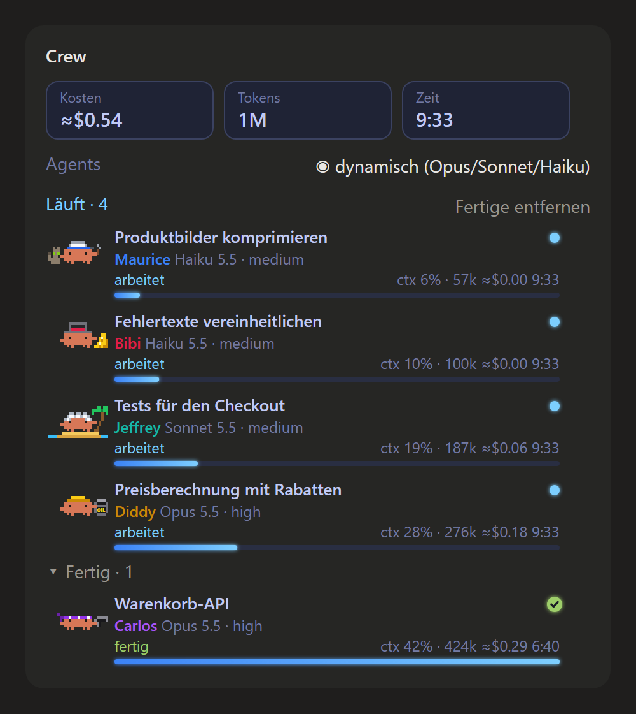
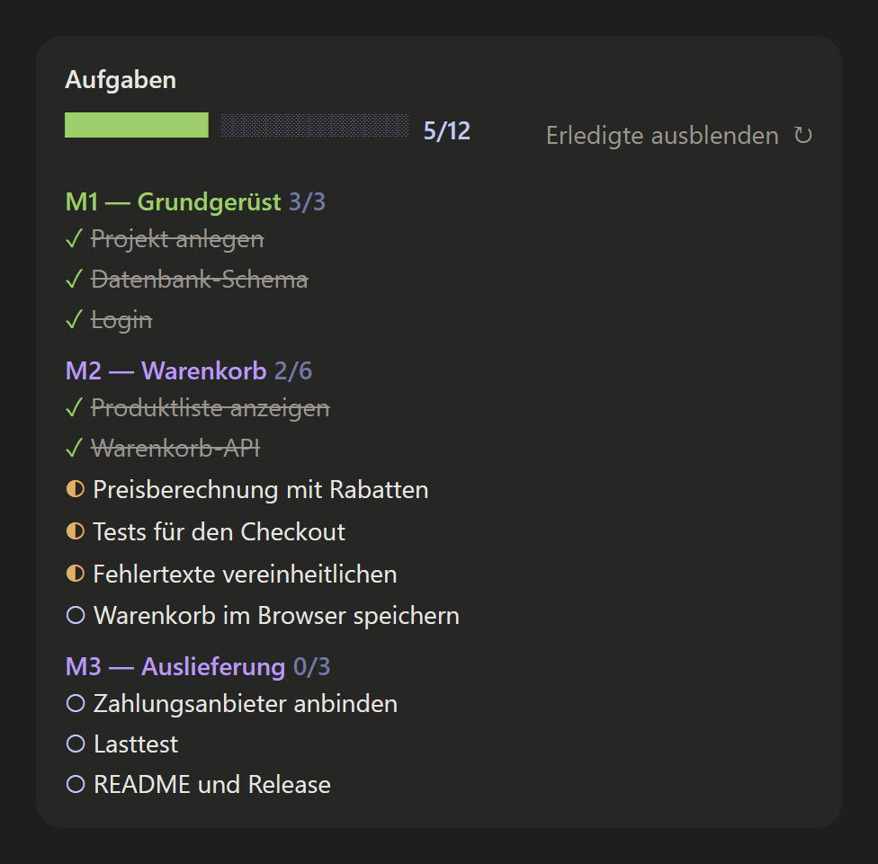
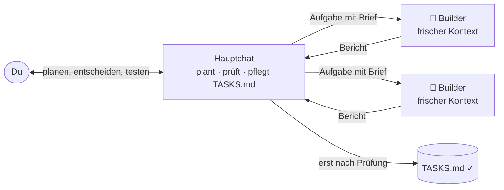

# builder-hud

**Eine Krabben-Crew für Claude Code.** Ein Band über der Chatzeile zeigt deinen Meilenstein, deine
Limits und jeden Agent, der gerade für dich arbeitet, als tanzende Pixel-Krabbe. Dazu kommt eine
Arbeitsweise, in der jede größere Aufgabe einen frischen Agent mit leerem Kontext bekommt.



> Inoffizieller Fan-Mod. Die Bilder hier zeichnet der Mod selbst, mit Demo-Daten.

## Was du bekommst

### Das Band über der Chatzeile



| Teil | Was es zeigt |
|---|---|
| **M2 2/6** links oben | Der aktuelle Meilenstein aus deiner `TASKS.md`: erledigt (glitzert), in Arbeit (blass), offen |
| **5h** und **C** | Dein 5-Stunden-Limit mit Zeit bis zum Reset, und wie voll das Kontextfenster ist |
| **Woche** in der Mitte | Dein Wochenlimit gegen ein gleichmäßiges Tempo: jeder Tag seit dem Reset zählt 1/7 (gut 14,3 %). Der helle Strich zeigt, wo du heute stehen würdest. **Blau** = noch Luft, **grün** = im Plan, **orange** = schneller als geplant |
| **Krabben** rechts | Wer gerade arbeitet, tanzt. Auch dann, wenn ein Agent nur auf seinen eigenen Hintergrundbefehl wartet |
| **Crew ×4** / **Aufgaben 5/12 ◐3** | Öffnen die beiden Panels |

### Die Crew



Beginnt die Beschreibung eines Agents mit einem Namen, trägt er dieses Kostüm, z. B.
`Diddy: Preisberechnung mit Rabatten`. Ohne Namen bekommt er das nächste freie.



Das **Crew-Panel** zeigt jeden Agent der Sitzung:

- Aufgabe, Modell und Effort
- Status, Kontext, Tokens, geschätzte Kosten und Laufzeit
- oben die Summen
- den Schalter für die **dynamischen Agents**

Fertige Agents klappen unten zusammen. Sobald einer fertig ist, kommt ein kurzer Hinweis:
„🦀 Carlos ist fertig: Warenkorb-API“.

<br clear="right">



Das **Aufgaben-Panel** zeigt deine `notes/TASKS.md`, gruppiert nach Meilensteinen.

- `✓` erledigt
- `◐` in Arbeit (ein Builder ist dran)
- `○` offen

Ein Klick hakt eine Aufgabe ab oder wieder auf. Die Datei bleibt normales Markdown, das du auch
von Hand bearbeiten kannst.

<br clear="right">

### Builder: ein frischer Agent pro Aufgabe

Das Plugin bringt den Agent-Typ **`builder`** mit (Opus, Effort High), dazu zwei kleinere (siehe
unten). Jeder startet mit leerem Kontext, bekommt eine in sich geschlossene Aufgabe, ändert nur die
erlaubten Dateien, prüft seine Arbeit selbst und meldet kurz zurück. Lange Befehle startet er im
Hintergrund und wartet, ohne Tokens zu verbrauchen.

**Dynamische Agents** (an per Standard): Neben dem Opus-Builder stehen zwei kleinere Builder bereit.
Claude wählt je Aufgabe den kleinsten passenden. Mit `/dynamisch` oder dem Schalter im Crew-Panel
schaltest du den Modus aus:

| Agent | Modell · Effort | Für |
|---|---|---|
| `builder` | Opus · high | schwere oder unklare Aufgaben: Entwurf, Fehlersuche, viele Dateien |
| `builder-medium` | Sonnet · medium | normale, klar beschriebene Aufgaben |
| `builder-light` | Haiku · medium | kleine, mechanische Aufgaben: Umbenennen, Formatieren, Nachschlagen |

Ist der Modus aus, sieht Claude nur den Opus-Builder. Die Wahl bleibt über Sitzungen erhalten; wer
ihn früher ausgeschaltet hat, behält „aus“.

**Cache für wartende Builder:** `builder` und `builder-medium` halten ihren Prompt-Cache 1 Stunde
(`experimental: cacheTtl: 1h` in ihrer Agent-Datei). Subagents bekommen sonst nur 5 Minuten, auch
mit Abo. Ein Builder, der länger auf einen Hintergrund-Build wartet, müsste beim Aufwachen seinen
ganzen Kontext neu in den Cache schreiben. Der Preis: Cache-Schreibvorgänge dieser Builder kosten
das 2-fache statt das 1,25-fache normaler Eingabe-Tokens. Darum gilt es nur für sie, nicht für
`builder-light` und andere Subagents wie Workflow-Agents, die selten lange warten. Braucht Claude
Code 2.1.248 oder neuer; solange dein Abo Zusatz-Guthaben verbraucht, nimmt Claude Code wieder 5
Minuten.

### `/workflow-init`: ein ganzer Arbeitsbereich in einem Schritt

In einem leeren Ordner richtet `/workflow-init` eine erprobte Arbeitsweise ein: Grundregeln
(`CLAUDE.md`), eine Wissenssammlung (`_instructions/`), ein Ordner pro Projekt mit `TASKS.md` und
`STATE.md` und die Befehle `/handoff` und `/update-guides`. Vorher fragt Claude in kurzen Runden,
was für ein Projekt es ist und wie du arbeiten willst.



- **Der Hauptchat** spricht mit dir, plant, schreibt Aufgaben und prüft Ergebnisse. Kleine
  Korrekturen macht er selbst.
- **Größere Aufgaben** gehen an einen Builder. Claude fragt vorher: „Soll ich daraus eine
  Builder-Aufgabe machen?“
- **Ein „fertig“ ist eine Behauptung:** Erst nach der Prüfung wird die Aufgabe in `TASKS.md`
  abgehakt.

Warum so: Ein frischer Agent arbeitet genauer als eine lange Sitzung mit vollem Kontext, und der
Hauptchat bleibt schlank.

#### Beispiel

> **Du:** Die nächsten drei Aufgaben aus M2 an Builder geben.
>
> **Claude:** Starte Diddy (Preisberechnung, Opus), Jeffrey (Checkout-Tests, Sonnet) und Bibi
> (Fehlertexte, Haiku). Sie arbeiten an getrennten Dateien.
>
> *… im Band tanzen drei Krabben, in `TASKS.md` stehen die Aufgaben auf ◐ …*
>
> **Claude:** Bibi ist fertig. Geprüft: die 14 Meldungen nutzen jetzt den gemeinsamen Text,
> `npm test` ist grün. Aufgabe abgehakt.

## Installieren

Starte `claude` in einem Terminal und tippe:

```
/plugin install builder-hud --marketplace aBigJohn/builder-hub
```

Bestätige „Add marketplace?“ mit `y` und wähle den Scope „user“. Danach läuft der Mod in jeder neuen
Sitzung, auch im Code-Tab der Desktop-App. Dort selbst gibt es den `/plugin`-Befehl nicht, deshalb
den Befehl im Terminal tippen.

Für einen neuen Arbeitsbereich: leeren Ordner anlegen, Claude Code darin öffnen, `/workflow-init`.

**Updates:** Jeder Commit hier ist eine neue Version.
- **Automatisch:** einmal in `claude` im Terminal `/plugin` öffnen → Tab „Marketplaces“ →
  `builder-hub` → „Enable auto-update“. Neue Versionen laufen ab der nächsten Sitzung.
- **Von Hand:** `claude plugin update builder-hud@builder-hub`, danach Claude neu starten oder
  `/reload-plugins`.

<details>
<summary><b>Von Hand installieren</b> (zum Mitentwickeln)</summary>

1. Das Repo klonen, z. B. nach `~/.claude/mods/builder-hub`.
2. Claude Code den Ordner nennen:
   - **Dauerhaft (auch für die Desktop-App):** in `~/.claude/settings.json`:
     ```json
     { "env": { "CLAUDE_CODE_PLUGIN_DIRS": "C:\\Users\\<du>\\.claude\\mods\\builder-hub" } }
     ```
     Mehrere Ordner trennst du mit `;` (Windows) bzw. `:`.
   - **Nur für eine Sitzung:** `claude --plugin-dir <pfad>/builder-hub`
3. Claude Code bzw. die App neu starten.

</details>

## Befehle und Optionen

| Befehl | Was er tut |
|---|---|
| `/workflow-init` | Arbeitsbereich im leeren Ordner einrichten, mit Interview |
| `/crew` | Crew-Panel öffnen |
| `/tasks` | Aufgaben-Panel öffnen |
| `/dynamisch` | Dynamische Agents an/aus |

| Option | Werte | Standard |
|---|---|---|
| `crew` | `alle`: jeder Agent bekommt eine Krabbe · `builder`: nur die Builder | `alle` |

Optionen stellst du im `/config`-Menü (Terminal) oder in `settings.json` unter `pluginConfigs` ein.

### Antwort-Stil `kurz`

Das Plugin bringt den Ausgabe-Stil `builder-hud:kurz` mit. Er ist automatisch an, solange das
Plugin aktiv ist. Claude antwortet dann kurz und einfach, nach den Regeln von ASD-STE100
(Simplified Technical English), in deiner Sprache:

- ein Gedanke pro Satz, aktiv, einfache Wörter
- zuerst das Ergebnis, Ziel höchstens 15 Zeilen
- Details nur auf Nachfrage oder als Datei

Kurze Antworten sparen Tokens: Du liest sie ganz, statt nachzufragen. Die normalen
Programmier-Regeln von Claude Code bleiben aktiv. Der Stil steht in `output-styles/kurz.md`.
Willst du ihn nicht, lösch in dieser Datei die Zeile `force-for-plugin: true`.

## Was er erwartet

Eine Aufgabenliste in `notes/TASKS.md` im Arbeitsordner oder in `projects/<name>/notes/TASKS.md`:

```markdown
# Tasks — Demo-Shop

## M1 — Erster Meilenstein
- [x] erledigt
- [~] in Arbeit
- [ ] offen
```

`##` startet einen Meilenstein, alle anderen Zeilen werden ignoriert. Ohne Liste zeigt das Band
nur Limits und Crew.

## Voraussetzungen

- Eine aktuelle Claude-Code-Version (Mods mit Hooks-Modul; getestet mit 2.1.295).
- Für den Builder ein Abo mit Opus. Opus mit hohem Effort kostet mehr als kleinere Modelle. Deshalb
  macht der Hauptchat kleine Korrekturen selbst, und der dynamische Modus spart bei leichten Aufgaben.
- Limits (5h, Woche) gibt es nur mit Abo; mit API-Key bleiben die Balken leer.
- `/workflow-init` ist auf Windows ausgelegt (`new-project.ps1`). Unter macOS/Linux braucht das
  Skript PowerShell 7 (`pwsh`), oder Claude legt das Projekt von Hand an.

Auf dem Desktop (Claude-App, Code-Tab) wird gezeichnet, im Terminal gibt es eine Textversion.

## Selbst anpassen

Die Kostüme liegen als JSON in `design-kit/designs/`. Wie du sie änderst und neu erzeugst, und wie
die Bilder hier entstehen, steht in `design-kit/README.md`. Tests: `claude plugin test .`

## Credits

- **Farben:** Tokyo-Night-Palette, die Farbwerte so, wie [claude-skins](https://github.com/hellosverre/claude-skins) sie ausliefert (MIT, © hellosverre). Übernommen wurden nur Farbwerte, kein Code.
- **Idee:** Fortschrittsbalken und Figuren pro Agent sind angeregt von `savvy-progress` / `savvy-flow` aus [claude-kit](https://github.com/JohnnyVizz/claude-kit). Von dort stammt kein Code.
- **Clawd:** Die Krabbe ist Clawd, das Maskottchen von Claude Code, als Pixel-Fanart. Das ist ein inoffizieller Fan-Mod und steht in keiner Verbindung zu Anthropic.

Lizenz: MIT, siehe `LICENSE`.
